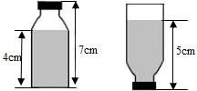

# Mathematics (Grade 6)

**ID**: f2e7ee01
**难度**: medium
**题型**: multiple_choice

## 题目
一个密封的瓶子里装着一些水（如图所示），已知瓶子的底面积为10 cm²，请你根据图中标明的数据，计算瓶子的容积是（   ）cm³．

$\begin{description}
\item A．80\item B．70\item C．60\item D．50
\end{description}$

## 解答

**答案**: C

1. Step1:根据第一个图可知水的高度为4cm，瓶子底面积为10cm²，根据圆柱体积公式V = sh（s是底面积，h是高），可得水的体积为10×4 = 40cm³
2. Step2:由第二个图可知，空白部分的高度为7 - 5 = 2cm，同样根据圆柱体积公式，空白部分体积为10×2 = 20cm³
3. Step3:瓶子的容积等于水的体积加上空白部分的体积，即40 + 20 = 60cm³，所以答案选C

## 知识点

**知识点**:
  - 小学数学;图形与几何;立体图形;圆柱和圆锥;圆柱的体积;不规则物体的体积算法;体积的等积变形

---
