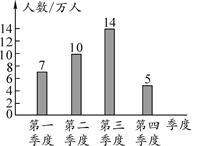

# Mathematics (Grade 6)

**ID**: f48c9289
**难度**: medium
**题型**: multiple_choice

## 题目
如图是一风景区2017年旅游人数统计图，从图中得到的信息不正确的是(  )

A．冬季旅游人数最少
B．第三季度比第二季度增加4万人
C．全年旅游人数共计36万人
D．1格代表1万1，所以7画在6与8的中间。

## 解答

**答案**: D

1. Step1:观察统计图可知，第四季度（冬季）旅游人数为5万人，是四个季度中人数最少的，所以选项A正确
2. Step2:第三季度旅游人数是14万人，第二季度旅游人数是10万人，14 - 10 = 4万人，即第三季度比第二季度增加4万人，选项B正确
3. Step3:全年旅游人数为7 + 10 + 14 + 5 = 36万人，选项C正确
4. Step4:观察统计图的纵轴，1格代表2万人，并非1万1，所以选项D不正确

## 知识点

**知识点**:
  - 小学数学;统计和概率;统计;统计图

---
