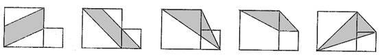

# Mathematics (Grade 6)

**ID**: f4d06155
**难度**: medium
**题型**: multiple_choice

## 题目
大正方形的边长10厘米，小正方形的边长5厘米，下面的图形中阴影部分面积一样大的图形有（   ）。

A．2个
B．3个
C．4个
D．5个

## 解答

**答案**: C

1. Step1:计算第一个图形阴影部分面积，它是一个底为10厘米，高为10厘米的平行四边形，根据平行四边形面积公式S = 底×高，可得面积为10×10 = 100平方厘米。
2. Step2:计算第二个图形阴影部分面积，它是一个底为10厘米，高为10厘米的三角形，根据三角形面积公式S = 底×高÷2，可得面积为10×10÷2 = 50平方厘米。
3. Step3:计算第三个图形阴影部分面积，它可看作一个底为10厘米，高为10厘米的三角形加上一个底为5厘米，高为5厘米的三角形，根据三角形面积公式，可得总面积为10×10÷2 + 5×5÷2 = 50 + 12.5 = 62.5平方厘米。
4. Step4:计算第四个图形阴影部分面积，它是一个底为10厘米，高为10厘米的三角形，面积为10×10÷2 = 50平方厘米。
5. Step5:计算第五个图形阴影部分面积，它可看作一个底为10厘米，高为10厘米的三角形加上一个底为5厘米，高为5厘米的三角形减去一个底为5厘米，高为5厘米的三角形，即面积为10×10÷2 = 50平方厘米。
6. Step6:对比发现第二个、第四个、第五个图形阴影部分面积都为50平方厘米，一样大，共3个。所以答案选B。

## 知识点

**知识点**:
  - 

---
