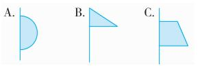

# Mathematics (Grade 6)

**ID**: f5c25300
**难度**: medium
**题型**: multiple_choice

## 题目
把下面（）图形，沿轴旋转一周可以得到圆锥。

## 解答

**答案**: B

1. Step1:分析选项A，根据面动成体，可知A沿轴旋转可得球
2. Step2:分析选项B，根据面动成体，可知B沿轴旋转可得圆锥
3. Step3:分析选项C，根据面动成体，可知C沿轴旋转可得圆台
4. Step4:题目要求沿轴旋转一周得到圆锥的图形，所以答案是B

## 知识点

**知识点**:
  - 圆锥的认识

---
