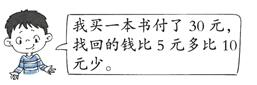

# Mathematics (Grade 6)

**ID**: f6cc8dc4
**难度**: medium
**题型**: multiple_choice

## 题目
选一选。这本书（   ）元钱。

A．20
B．22
C．27

## 解答

**答案**: B

1. Step1:已知付了30元，找回的钱比5元多比10元少，所以书的价格范围是30 - 10 < 书的价格 < 30 - 5，即20 < 书的价格 < 25。
2. Step2:分析选项，A选项20元不满足20 < 书的价格；B选项22元满足20 < 22 < 25；C选项27元不满足书的价格 < 25。
3. Step3:所以这本书22元，答案选B。

## 知识点

**知识点**:
  - 小学数学;数与代数;数的运算;整数的四则运算;退位减法

---
