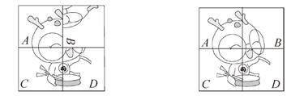

# Mathematics (Grade 6)

**ID**: f7bec348
**难度**: medium
**题型**: multiple_choice

## 题目
下面左图中的B绕自己的中心点（   ）时针旋转（   ）°后得到右图，正确的是（    ）。

$\begin{description}
\item A．顺90\item B．逆90\item C．顺180
\end{description}$

## 解答

**答案**: B

1. Step1:观察左图和右图中B的位置和方向变化
2. Step2:根据旋转的性质判断，发现B绕自己的中心点逆时针旋转
3. Step3:进一步确定旋转角度为90°
4. Step4:对比选项，得出答案为B

## 知识点

**知识点**:
  - 小学数学;图形与几何;图形与变换;旋转三要素及旋转图形

---
