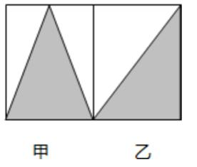

# Mathematics (Grade 6)

**ID**: f8118c6d
**难度**: medium
**题型**: multiple_choice

## 题目
图中，边长相等的两个正方形中，画了甲、乙两个三角形(用阴影表示)， 它们的面积相比（ ）

A．甲的面积大
B．乙的面积大
C．相等

## 解答

**答案**: C

1. Step1:设正方形的边长为a。
2. Step2:根据三角形面积公式S = 1/2×底×高，甲三角形的底是a，高是a，其面积为1/2×a×a = 1/2a²。
3. Step3:乙三角形的底是a，高是a，其面积为1/2×a×a = 1/2a²。
4. Step4:比较甲、乙三角形面积，因为甲三角形面积为1/2a²，乙三角形面积也为1/2a²，所以甲、乙两个三角形面积相等。

## 知识点

**知识点**:
  - 

---
