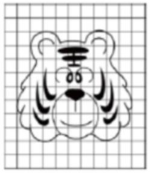

# Mathematics (Grade 6)

**ID**: fbeff4a6
**难度**: medium
**题型**: multiple_choice

## 题目
如图所示，每个小正方形的面积为1$\textit{cm}^{2}$，请你估计一下这个老虎图片的面积约是（ ）cm$^{2}$．

$\begin{description}
\item A．20\item B．35\item C．56\item D．81
\end{description}$

## 解答

**答案**: C

1. Step1:观察老虎图片在方格中的占格情况
2. Step2:采用数方格的方法估算面积，满格算1格，不满格算半格
3. Step3:数出满格和不满格的数量并计算总面积
4. Step4:对比各选项，得出答案为C

## 知识点

**知识点**:
  - 小学数学;图形与几何;平面图形;不规则图形的面积

---
