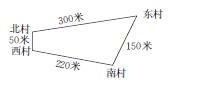

# Mathematics (Grade 6)

**ID**: feeb3d65
**难度**: medium
**题型**: multiple_choice

## 题目
如图,从西村到东村有两条路,最近的一条路是(   )。

$\begin{description}
\item A．西村——北村——东村\item B．西村——南村——东村\item C．无法判断
\end{description}$

## 解答

**答案**: A

1. Step1:计算A路线的长度，即西村到北村的50米加上北村到东村的300米，50 + 300 = 350米
2. Step2:计算B路线的长度，即西村到南村的220米加上南村到东村的150米，220 + 150 = 370米
3. Step3:比较两条路线的长度，350米 < 370米，A路线更短，所以最近的路是西村——北村——东村

## 知识点

**知识点**:
  - 

---
