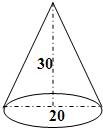

# Mathematics (Grade 6)

**ID**: 0035e678
**难度**: medium
**题型**: short_answer

## 题目
计算下面圆锥的体积(单位：cm)

## 解答

**答案**: 3140

1. Step1:明确圆锥体积公式为$v=\frac{1}{3}sh$，其中$s$是底面积，$h$是高
2. Step2:由底面直径20cm，计算底面半径为20÷2 = 10cm
3. Step3:根据圆的面积公式$s = 3.14×r^{2}$，计算圆锥的底面积为3.14×10^{2}=3.14×100
4. Step4:已知圆锥的高为30cm，将底面积和高代入圆锥体积公式，得到$\frac{1}{3}×3.14×100×30$
5. Step5:计算$\frac{1}{3}×3.14×100×30$的结果为3140立方厘米

## 知识点

**知识点**:
  - 圆锥的体积．

---
