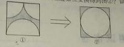

# Mathematics (Grade 6)

**ID**: 073df757
**难度**: medium
**题型**: short_answer

## 题目
如图，图①可以经过哪些变换得到图②？试写出其中的一种

## 解答

**答案**: 先把上半部分的两个四分之一圆左右调换位置，再把上下的两个半圆上下换位即可得到右图中的图案

1. Step1:观察图①和图②的差异，确定需要变换的部分为上半部分的两个四分之一圆和上下的两个半圆
2. Step2:先将图①上半部分的两个四分之一圆进行左右调换位置
3. Step3:接着把经过步骤2变换后的图形中的上下两个半圆进行上下换位操作
4. Step4:经过上述两步变换后得到图②的图案

## 知识点

**知识点**:
  - 

---
