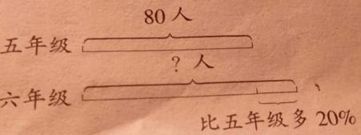

# Mathematics (Grade 6)

**ID**: 0c492392
**难度**: medium
**题型**: short_answer

## 题目

 五年级80人，六年级比五年级多20%

## 解答

**答案**: 96

1. Step1:明确五年级人数为80人
2. Step2:分析得出六年级人数是五年级人数的(1 + 20%)
3. Step3:根据求一个数的几分之几是多少用乘法计算，列出算式80×(1 + 20%)
4. Step4:计算1 + 20% = 1.2
5. Step5:计算80×1.2 = 96，得出六年级人数为96人

## 知识点

**知识点**:
  - --

---
