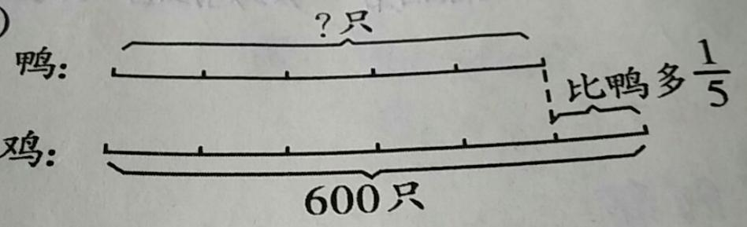

# Mathematics (Grade 6)

**ID**: 0e7d1360
**难度**: medium
**题型**: short_answer

## 题目

 鸭：？只        鸡：   600只        比鸭多
 $\frac{1}{5}$

## 解答

**答案**: 500

1. Step1:明确鸡的数量是600只，且鸡的数量比鸭多$rac{1}{5}$，把鸭的数量看作单位'1'。
2. Step2:可知鸡的数量是鸭的数量的$1+rac{1}{5}=rac{6}{5}$倍。
3. Step3:因为已知鸡的数量为600只，求单位'1'（鸭的数量），根据求单位'1'用除法，所以用鸡的数量600除以鸡是鸭的倍数$rac{6}{5}$，即$600\divrac{6}{5}$。
4. Step4:计算$600\divrac{6}{5}=600	imesrac{5}{6}=500$只，得出鸭的数量为500只。

## 知识点

**知识点**:
  - --

---
