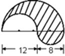

# Mathematics (Grade 6)

**ID**: 156e674d
**难度**: medium
**题型**: short_answer

## 题目
求下面图形中阴影部分的面积．（单位：cm）

## 解答

**答案**: 125.6平方厘米

1. Step1:计算大半圆的半径，(12 + 8)÷2 = 10（厘米）
2. Step2:计算空白小半圆的半径，12÷2 = 6（厘米）
3. Step3:计算右侧小半圆的半径，8÷2 = 4（厘米）
4. Step4:计算大半圆面积的一半，3.14×10²÷2
5. Step5:计算空白小半圆面积的一半，3.14×6²÷2
6. Step6:计算右侧小半圆面积的一半，3.14×4²÷2
7. Step7:用大半圆面积的一半减去空白小半圆面积的一半再加上右侧小半圆面积的一半，即 3.14×10²÷2 - 3.14×6²÷2 + 3.14×4²÷2 = 125.6（平方厘米）

## 知识点

**知识点**:
  - 小学数学;图形与几何

---
