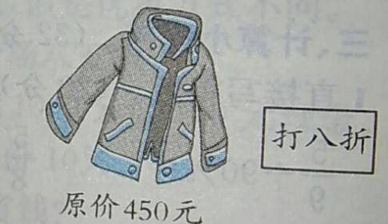

# Mathematics (Grade 6)

**ID**: 257245b7
**难度**: medium
**题型**: short_answer

## 题目
这件衣服的现价比原价便宜多少钱？ （7分）

 打八折  原价450元

## 解答

**答案**: 90

1. Step1:明确打八折的含义，即现价是原价的80%，已知原价为450元，所以现价为450×80% = 360元
2. Step2:根据原价-现价=便宜的钱数这一关系式，用原价450元减去现价360元，即450 - 360 = 90元

## 知识点

**知识点**:
  - 

---
