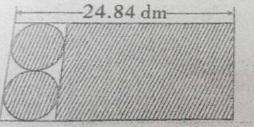

# Mathematics (Grade 6)

**ID**: 26987015
**难度**: medium
**题型**: short_answer

## 题目
下图阴影部分正好组成一个圆柱，求圆柱的表面积。

 24.84dm

## 解答

**答案**: 75.36cm²

1. Step1:设圆柱的半径为r
2. Step2:根据条件列出方程2r + 3.14×2r = 24.84
3. Step3:解方程得出r = 3
4. Step4:根据圆柱表面积公式计算，先计算两个底面积3.14×3²×2
5. Step5:再计算侧面积3.14×2×3
6. Step6:将底面积和侧面积相加得到圆柱的表面积3.14×3²×2 + 3.14×2×3 = 75.36cm²

## 知识点

**知识点**:
  - 

---
