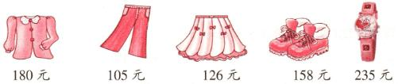

# Mathematics (Grade 6)

**ID**: 2d71cc79
**难度**: medium
**题型**: short_answer

## 题目
购物．

（1）买一件上衣和一条裙子共需多少钱？
（2）小丽带了300元钱，买了一块手表，还剩多少钱？
（3）一双鞋子比一件上衣便宜多少钱？

## 解答

**答案**: 306, 65, 22

1. Step1:根据题目，求买一件上衣和一条裙子共需多少钱，已知上衣价格180元，裙子价格126元，依据加法的意义，将二者单价相加，即180 + 126 = 306元
2. Step2:求小丽带300元买一块手表后还剩多少钱，已知手表价格235元，依据减法的意义，用300减去手表单价，即300 - 235 = 65元
3. Step3:求一双鞋子比一件上衣便宜多少钱，已知鞋子价格158元，上衣价格180元，依据减法的意义，用上衣单价减去鞋子单价，即180 - 158 = 22元

## 知识点

**知识点**:
  - 整数、小数复合应用题．

---
