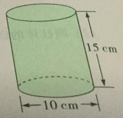

# Mathematics (Grade 6)

**ID**: 2edcd402
**难度**: medium
**题型**: short_answer

## 题目
小东做了一个笔筒（如图），他想给笔筒的侧面贴上彩纸，至少需要多少平方厘米的彩纸？

 10cm   15cm

## 解答

**答案**: 471

1. Step1:根据圆的周长公式C = πd（d为直径），由已知笔筒底面直径为10cm，可得底面周长为3.14×10 = 31.4厘米
2. Step2:已知笔筒的高为15cm，根据圆柱侧面积公式S = 底面周长×高，可得侧面积为31.4×15 = 471平方厘米

## 知识点

**知识点**:
  - 

---
