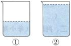

# Mathematics (Grade 6)

**ID**: 3027086e
**难度**: medium
**题型**: short_answer

## 题目
如下图，有两杯糖水，①号杯装水81g，放入19g的糖；②号杯装水170g，放人30g的糖。你认为这两杯糖水，哪一杯糖水较甜？

## 解答

**答案**: ①号杯糖水较甜

1. Step1:计算①号杯糖占糖水的百分比，即19÷(81 + 19) = 19%
2. Step2:计算②号杯糖占糖水的百分比，即30÷(170 + 30) = 15%
3. Step3:比较两杯糖水糖占比大小，19% > 15%
4. Step4:得出结论，①号杯糖水较甜

## 知识点

**知识点**:
  - 小学数学;数与代数;应用题;百分数应用题;百分数简单应用题

---
