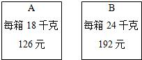

# Mathematics (Grade 6)

**ID**: 3094d009
**难度**: medium
**题型**: short_answer

## 题目
小红和妈妈去买苹果，看到A、B两种不同标价的苹果，买那种苹果便宜？

## 解答

**答案**: A种苹果便宜

1. Step1:根据单价=总价÷数量，计算A种苹果单价，即126÷18=7（元/千克）
2. Step2:根据单价=总价÷数量，计算B种苹果单价，即192÷24=8（元/千克）
3. Step3:比较两种苹果单价，7元/千克＜8元/千克，得出A种苹果便宜

## 知识点

**知识点**:
  - 整数、小数复合应用题．

---
