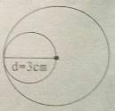

# Mathematics (Grade 6)

**ID**: 38033741
**难度**: medium
**题型**: short_answer

## 题目
如图，以大圆的半径为直径画一小圆，求大圆面积与小圆面积的比.

 d=3cm

## 解答

**答案**: 4：1

1. Step1:根据已知条件，小圆的直径d = 3cm，由半径是直径的一半，可得小圆半径为3÷2 = 1.5cm
2. Step2:已知大圆半径等于小圆的直径，即大圆半径为3cm
3. Step3:根据圆的面积公式S = πr²，可得大圆面积为π×3²，小圆面积为π×1.5²
4. Step4:计算大圆面积与小圆面积的比，即π×3²：π×1.5²，π可约掉，得到3²：1.5² = 9：2.25
5. Step5:将9：2.25化简，得到4：1

## 知识点

**知识点**:
  - --

---
