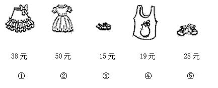

# Mathematics (Grade 6)

**ID**: 3cc5d3e9
**难度**: medium
**题型**: short_answer

## 题目
配衣服。

（1）小红要买①和④要花多少钱？
（2）小兰用100元买了②和③还剩多少钱？
（3）⑤比③贵了多少钱？

## 解答

**答案**: 57, 35, 13

1. Step1:计算小红买①和④要花的钱，①价格是38元，④价格是19元，所以花费为38 + 19 = 57元
2. Step2:计算小兰用100元买②和③后剩余的钱，②价格是50元，③价格是15元，先算出买②和③总共花费50 + 15 = 65元，再用100减去花费的65元，即100 - 65 = 35元
3. Step3:计算⑤比③贵的钱数，⑤价格是28元，③价格是15元，所以贵了28 - 15 = 13元

## 知识点

**知识点**:
  - 小学数学;数与代数;应用题;简单应用题;整数简单应用题

---
