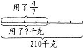

# Mathematics (Grade 6)

**ID**: 3d3bcca1
**难度**: medium
**题型**: short_answer

## 题目
看线段列式计算．

## 解答

**答案**: 120

1. Step1:明确物品总量为210千克
2. Step2:确定用去的部分占总量的分率为$rac{4}{7}$
3. Step3:根据分数乘法的意义，用总量210千克乘以用去部分占总量的分率$rac{4}{7}$，即210×$rac{4}{7}$
4. Step4:计算210×$rac{4}{7}$的结果为120千克

## 知识点

**知识点**:
  - 分数乘法应用题．

---
