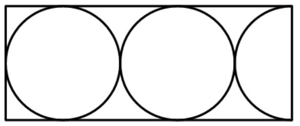

# Mathematics (Grade 6)

**ID**: 4022a616
**难度**: medium
**题型**: short_answer

## 题目
下图中长方形的长是25厘米，则长方形的周长是多少厘米？

## 解答

**答案**: 70

1. Step1:观察图形可知长方形的长等于 5 个圆的半径，已知长方形长为 25 厘米，所以圆的半径为 25÷5 = 5 厘米
2. Step2:因为长方形的宽等于圆的直径，所以长方形的宽为 5×2 = 10 厘米
3. Step3:根据长方形周长公式 C=(a + b)×2（其中 a 为长，b 为宽），这里 a = 25 厘米，b = 10 厘米，所以长方形周长为(25 + 10)×2 = 70 厘米

## 知识点

**知识点**:
  - --

---
