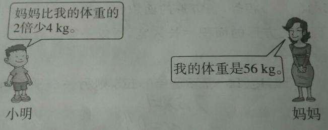

# Mathematics (Grade 6)

**ID**: 420e706a
**难度**: medium
**题型**: short_answer

## 题目

 小明   妈妈比我的体重的2倍少4kg．
 妈妈   我的体重是56kg．
 小明的体重是多少千克？

## 解答

**答案**: 30

1. Step1:设小明的体重是x千克
2. Step2:根据已知条件得出等式2x - 4 = 56
3. Step3:等式两边同时加4，得到2x = 56 + 4
4. Step4:计算56 + 4 = 60，即2x = 60
5. Step5:等式两边同时除以2，得到x = 60÷2
6. Step6:计算60÷2 = 30，得出x = 30，所以小明体重是30千克

## 知识点

**知识点**:
  - --

---
