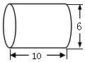

# Mathematics (Grade 6)

**ID**: 43c413dd
**难度**: medium
**题型**: short_answer

## 题目
计算如图的表面积．（单位：厘米）

## 解答

**答案**: 244.92

1. Step1:根据圆柱表面积公式，圆柱的表面积=侧面积+两个底面积，其中侧面积=底面周长×高，底面积=3.14×半径×半径。
2. Step2:由图可知圆柱的高为10厘米，底面直径为6厘米，所以底面半径为6÷2=3厘米。
3. Step3:计算底面周长为3.14×6=18.84厘米。
4. Step4:计算侧面积为18.84×10=188.4平方厘米。
5. Step5:计算一个底面积为3.14×3×3=28.26平方厘米。
6. Step6:计算两个底面积为28.26×2=56.52平方厘米。
7. Step7:计算圆柱的表面积为188.4+56.52=244.92平方厘米。

## 知识点

**知识点**:
  - 小学数学;数与代数;数的运算;小数的四则运算;小数的四则运算及法则

---
