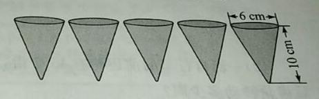

# Mathematics (Grade 6)

**ID**: 43c8c9b7
**难度**: medium
**题型**: short_answer

## 题目
一瓶500毫升的果汁，可以倒满下面5个同样大小的圆锥形容器吗？

 6cm    10cm

## 解答

**答案**: 可以倒满下面5个同样大小的圆锥形容器

1. Step1:根据圆锥底面直径为6cm，可得底面半径为6÷2 = 3cm
2. Step2:根据圆的面积公式S = πr²，其中π取3.14，r = 3cm，可算出圆锥的底面积为3.14×3² = 3.14×9cm²
3. Step3:已知圆锥的高为10cm，根据圆锥体积公式V = 底面积×高÷3，可算出一个圆锥形容器的体积为3.14×9×10÷3cm³
4. Step4:因为有5个同样大小的圆锥形容器，所以5个圆锥形容器的总体积为3.14×9×10÷3×5cm³，计算得出为471cm³
5. Step5:因为1cm³ = 1mL，所以471cm³ = 471mL
6. Step6:将5个圆锥形容器的总体积471mL与果汁的体积500mL比较，471mL < 500mL，得出可以倒满

## 知识点

**知识点**:
  - 

---
