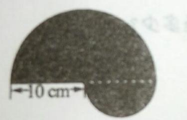

# Mathematics (Grade 6)

**ID**: 45b7fe1d
**难度**: medium
**题型**: short_answer

## 题目
求下面涂色部分的面积.
。

## 解答

**答案**: 78.975cm²

1. Step1:确定大圆半径为10÷2 = 5cm
2. Step2:确定小圆半径为5÷2 = 2.5cm
3. Step3:计算大圆面积为3.14×5²
4. Step4:计算小圆面积为3.14×2.5²
5. Step5:计算大圆面积与小圆面积之和为3.14×5² + 3.14×2.5²
6. Step6:计算涂色部分面积为(3.14×5² + 3.14×2.5²)÷2 = 78.975cm²

## 知识点

**知识点**:
  - --

---
