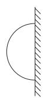

# Mathematics (Grade 6)

**ID**: 4e74ec64
**难度**: medium
**题型**: short_answer

## 题目
王老伯要靠墙围一个半圆形栅栏。这个半圆的直径是15米，栅栏长多少米？

## 解答

**答案**: 23.55

1. Step1:明确圆的周长公式为C = πd（C表示圆的周长，d表示圆的直径，π通常取3.14）
2. Step2:已知半圆的直径d = 15米，先根据圆的周长公式求出整圆的周长，即C = 3.14×15
3. Step3:因为栅栏是半圆形，其长度是圆周长的一半，所以将整圆的周长除以2，即3.14×15÷2
4. Step4:计算3.14×15÷2的结果为23.55米

## 知识点

**知识点**:
  - 圆的周长

---
