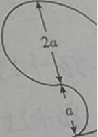

# Mathematics (Grade 6)

**ID**: 4fc681fb
**难度**: medium
**题型**: short_answer

## 题目
图中的图形由三个半圆围城，求这个图形的周长。(结果要化简，可保留
  π)

## 解答

**答案**: 3aπ

1. Step1:根据半圆周长公式，直径为2a的半圆周长为2aπ÷2
2. Step2:直径为(2a + a)即3a的半圆周长为(2a + a)π÷2 = 3aπ÷2
3. Step3:直径为a的半圆周长为aπ÷2
4. Step4:将三个半圆的周长相加，得到2aπ÷2 + (2a + a)π÷2 + aπ÷2
5. Step5:对2aπ÷2 + 3aπ÷2 + aπ÷2进行计算，2aπ÷2 = aπ，3aπ÷2 = 1.5aπ，aπ÷2 = 0.5aπ，即aπ + 1.5aπ + 0.5aπ
6. Step6:合并同类项，aπ + (1.5aπ + 0.5aπ) = aπ + 2aπ
7. Step7:最终得出结果为3aπ

## 知识点

**知识点**:
  - --

---
