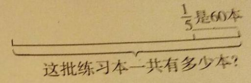

# Mathematics (Grade 6)

**ID**: 506ef5d2
**难度**: medium
**题型**: short_answer

## 题目

 一批练习本的
 $\frac{1}{5}$
  是60本，这批练习本一共有多少本？

## 解答

**答案**: 300

1. Step1:明确已知条件为一批练习本的$\frac{1}{5}$是60本，要求这批练习本的总数
2. Step2:根据‘知道一个数的几分之几，求这个数用除法’的原则，确定用60除以$\frac{1}{5}$来计算总数
3. Step3:计算$60\div\frac{1}{5}$，根据分数除法法则，$60\div\frac{1}{5}=60×5$
4. Step4:得出$60×5 = 300$本，即这批练习本一共有300本

## 知识点

**知识点**:
  - --

---
