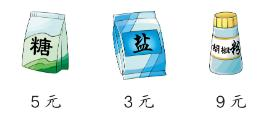

# Mathematics (Grade 6)

**ID**: 5313cdfa
**难度**: medium
**题型**: short_answer

## 题目
小军拿了20元钱，要买一袋糖和一袋盐。

（ 1）还剩下多少钱？
（2）剩下的钱够买一瓶胡椒粉吗？
（3）你还能提出其它数学问题吗？并解答。

## 解答

**答案**: 12（元）, 够, 17（元）

1. Step1:先计算买一袋糖和一袋盐花费的钱，糖5元，盐3元，共5 + 3 = 8元
2. Step2:用小军拿的20元减去买糖和盐花费的8元，即20 - 8 = 12元，得到剩下的钱数，回答问题（1）
3. Step3:胡椒粉9元，比较剩下的12元和胡椒粉价格9元，12 > 9，得出剩下的钱够买一瓶胡椒粉，回答问题（2）
4. Step4:提出问题“这三种东西一共多少钱？”，将糖5元、盐3元、胡椒粉9元相加，5 + 3 + 9 = 17元，回答问题（3）

## 知识点

**知识点**:
  - 小学数学;数与代数;数的认识;整数的认识;20以内数的认识;20以内数的比大小;数的运算;整数的四则运算;应用题;常见的数学问题;“提问题”“填条件”问题

---
