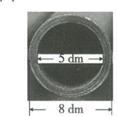

# Mathematics (Grade 6)

**ID**: 5b188c80
**难度**: medium
**题型**: short_answer

## 题目
一根钢管的横截面是一个环形，这根钢管的横截面的面积是多少平方分米？

 8dm  5dm

## 解答

**答案**: 0.30615

1. Step1:确定外圆半径，由图可知外圆直径为8dm，所以外圆半径R = 8÷2 = 4dm
2. Step2:确定内圆半径，由图可知内圆直径为5dm，所以内圆半径r = 5÷2 = 2.5dm
3. Step3:根据环形面积公式环形面积 = 3.14×（R² - r²），将R = 4dm，r = 2.5dm代入公式，得到3.14×(4² - 2.5²)
4. Step4:计算4² - 2.5² = 16 - 6.25 = 9.75
5. Step5:计算3.14×9.75 = 30.615dm²

## 知识点

**知识点**:
  - 圆;简单组合图形的面积

---
