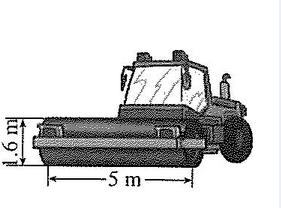

# Mathematics (Grade 6)

**ID**: 5f3f42fd
**难度**: medium
**题型**: short_answer

## 题目
如图；压路机前轮转动1周，压路的面积是多少平方米?

## 解答

**答案**: 8π

1. Step1:明确求压路机前轮转动1周压路的面积就是求圆柱的侧面积
2. Step2:确定圆柱侧面积公式为S = πd×h，其中d是底面直径，h是圆柱的高
3. Step3:由图可知底面直径d = 1.6米，高h = 5米
4. Step4:将d = 1.6米，h = 5米代入公式S = πd×h，得到S = π×1.6×5
5. Step5:计算π×1.6×5 = 8π平方米

## 知识点

**知识点**:
  - 期末测试卷-期末测试卷
-

---
