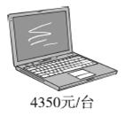

# Mathematics (Grade 6)

**ID**: 607f748b
**难度**: medium
**题型**: short_answer

## 题目
2017年8月，小红的妈妈将4000元钱存入银行，定期三年，年利率为2.75%，三年到期后，准备用这笔钱购买下面的电脑，钱够吗？ 

## 解答

**答案**: 不够

1. Step1:根据公式本金+本金×时间×利率=到期后可取的钱数，本金为4000元，时间是3年，年利率为2.75%，计算到期后可取的钱数为4000＋4000×3×2.75%=4330元
2. Step2:已知电脑价格为4350元，将到期后可取的钱数4330元与电脑价格4350元比较，得到4330＜4350
3. Step3:根据比较结果判断钱不够

## 知识点

**知识点**:
  - 小学数学;数与代数;应用题;百分数应用题;百分数的实际应用题

---
