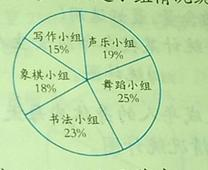

# Mathematics (Grade 6)

**ID**: 621d3b25
**难度**: medium
**题型**: short_answer

## 题目
下面是同学们参加兴趣小组情况统计图。

 写作小组15% 声乐小组19% 象棋小组18% 舞蹈小组25% 书法小组23%
 参加声乐小组的同学有76人，参加兴趣小组的总人数有多少人？

## 解答

**答案**: 400

1. Step1:明确已知条件，声乐小组人数为76人，声乐小组人数占参加兴趣小组总人数的19%
2. Step2:因为把参加兴趣小组的人数看做单位“1”，要求单位“1”的量，根据已知一个数的百分之几是多少，求这个数用除法的原理
3. Step3:用声乐小组的人数76除以其占总人数的百分比19%，即76÷19%，得出参加兴趣小组的总人数为400人

## 知识点

**知识点**:
  - 

---
