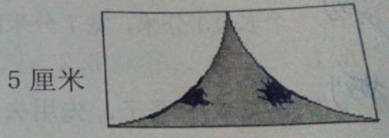

# Mathematics (Grade 6)

**ID**: 67cea3e6
**难度**: medium
**题型**: short_answer

## 题目
求出阴影部分的周长和面积．

 5厘米

## 解答

**答案**: 25.7, 10.75

1. Step1:求阴影部分周长，阴影部分周长由两个四分之一圆弧长和两条长方形的宽组成，两个四分之一圆弧长合起来是一个半圆的弧长，根据圆的周长公式C = 2×π×r（其中C表示圆的周长，π取3.14，r为半径），半圆的弧长为2×5×3.14÷2，再加上两条长方形的宽5×2，可得周长为2×5×3.14÷2 + 5×2 = 15.7 + 10 = 25.7厘米
2. Step2:求阴影部分面积，用长方形的面积减去两个四分之一圆的面积，长方形的长是5×2厘米，宽是5厘米，根据长方形面积公式S = a×b（其中S表示长方形面积，a为长，b为宽），长方形面积为5×5×2，两个四分之一圆合起来是一个半圆，根据圆的面积公式S = π×r×r（其中S表示圆的面积，π取3.14，r为半径），半圆面积为5²×3.14÷2，所以面积为5×5×2 - (5²×3.14÷2) = 50 - 39.25 = 10.75平方厘米

## 知识点

**知识点**:
  - --

---
