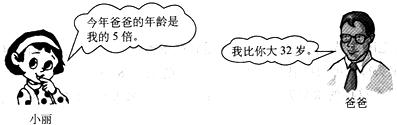

# Mathematics (Grade 6)

**ID**: 6a2daaec
**难度**: medium
**题型**: short_answer

## 题目

小丽今年多少岁？(用方程解)

## 解答

**答案**: 8

1. Step1:设小丽今年X岁，因为今年爸爸的年龄是小丽的5倍，所以爸爸的年龄是5X岁
2. Step2:根据爸爸比小丽大32岁，得到数量关系爸爸的年龄 - 小丽的年龄 = 32，即5X - X = 32
3. Step3:对5X - X进行化简，得到4X = 32
4. Step4:求解方程4X = 32，两边同时除以4，即X = 32÷4
5. Step5:计算32÷4的值为8，所以X = 8，即小丽今年8岁

## 知识点

**知识点**:
  - 差倍问题．

---
