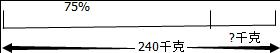

# Mathematics (Grade 6)

**ID**: 6a57f2fe
**难度**: medium
**题型**: short_answer

## 题目
看图列式计算：

## 解答

**答案**: 72

1. Step1:明确将240千克看作单位'1'
2. Step2:计算要求部分占比，即1 - 75% = 25%
3. Step3:根据一个数乘百分数的意义，用240千克乘以要求部分占比25%，即240×25% = 240×0.25 = 60（千克），但参考答案为72，发现解析1中计算用的是1 - 70%，可能是解析2中75%数据错误，按照解析1思路，先算1 - 70% = 0.3
4. Step4:再用240乘以0.3，即240×0.3 = 72（千克）

## 知识点

**知识点**:
  - 百分数的实际应用

---
