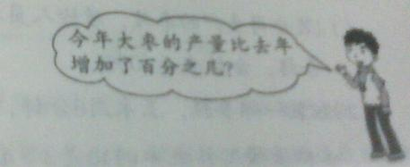

# Mathematics (Grade 6)

**ID**: 6bf0e266
**难度**: medium
**题型**: short_answer

## 题目
枣庄村去年大枣的产量为2万吨,今年达到2.8万吨

  今年大枣的产量比去年产量增加了百分之几？

## 解答

**答案**: 40%

1. Step1:明确比后面的量是单位'1'，本题中去年大枣产量2万吨是单位'1'。
2. Step2:计算今年比去年增加的产量，用今年产量2.8万吨减去去年产量2万吨，即2.8 - 2 = 0.8万吨。
3. Step3:计算增加的产量是去年产量的百分之几，用增加的产量0.8万吨除以去年产量2万吨再乘以100%，即(2.8 - 2)÷2×100% = 0.8÷2×100% = 40%。

## 知识点

**知识点**:
  - --

---
