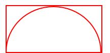

# Mathematics (Grade 6)

**ID**: 72445873
**难度**: medium
**题型**: short_answer

## 题目
下图中长方形的面积是50dm$^{2}$，求半圆的面积。

## 解答

**答案**: 39.25dm$^{2}$

1. Step1:设圆的半径为r，因为半圆在长方形内，所以长方形的长为2r dm，宽为r dm
2. Step2:根据长方形面积公式S = 长×宽，可得2r×r = 50，即2r² = 50
3. Step3:由2r² = 50，计算得出r² = 25
4. Step4:根据半圆面积公式S = πr²÷2，将r² = 25代入，得到半圆面积为3.14×25÷2
5. Step5:计算3.14×25÷2 = 39.25（dm²）

## 知识点

**知识点**:
  - 

---
