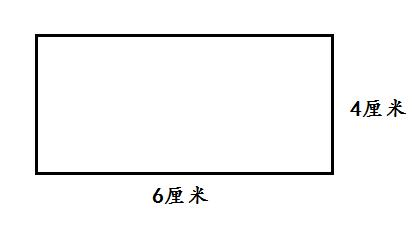

# Mathematics (Grade 6)

**ID**: 757c47f3
**难度**: medium
**题型**: short_answer

## 题目
在下面长方形纸片上剪一个最大的圆，这个圆的周长是多少厘米？

 4厘米 6厘米

## 解答

**答案**: 12.56

1. Step1:明确在长方形中剪最大圆，其直径等于长方形较短边，此长方形较短边为4厘米，所以圆的直径d = 4厘米
2. Step2:根据圆的周长公式C = πd，π取3.14，计算圆的周长C = 3.14×4 = 12.56厘米

## 知识点

**知识点**:
  - --

---
