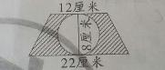

# Mathematics (Grade 6)

**ID**: 7a9c20ae
**难度**: medium
**题型**: short_answer

## 题目
求下图阴影部分的面积

 12厘米 8厘米 22厘米

## 解答

**答案**: 85.76

1. Step1:根据梯形面积公式$S_1=(a + b)h÷2$（其中$a = 12$厘米，$b = 22$厘米，$h = 8$厘米），计算梯形面积$S_1=(12 + 22)×8÷2$
2. Step2:根据圆的面积公式$S_2 = \pi r^2$（其中$r = 8÷2$厘米，$\pi$取3.14），计算圆的面积$S_2=(8÷2)^2×3.14$
3. Step3:用梯形面积$S_1$减去圆的面积$S_2$，即$(12 + 22)×8÷2-(8÷2)^2×3.14$，得出阴影部分面积为85.76平方厘米

## 知识点

**知识点**:
  - 

---
