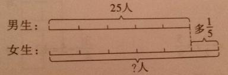

# Mathematics (Grade 6)

**ID**: 7dfc2bc9
**难度**: medium
**题型**: short_answer

## 题目
看图列式计算。
 

 男生25人  女生多
 $\frac{1}{5}$

## 解答

**答案**: 30

1. Step1:明确男生人数为25人，且把男生人数看作单位'1'
2. Step2:因为女生比男生多$\frac{1}{5}$，所以女生人数是男生人数的$1 + \frac{1}{5}$倍
3. Step3:根据已知一个数，求它的几倍是多少用乘法，计算女生人数为$25×(1 + \frac{1}{5})$
4. Step4:计算$25×(1 + \frac{1}{5}) = 25×\frac{6}{5} = 30$人

## 知识点

**知识点**:
  - --

---
