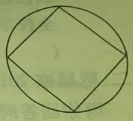

# Mathematics (Grade 6)

**ID**: 80be9754
**难度**: medium
**题型**: short_answer

## 题目
已知下图中圆的周长是75.36cm，求正方形的面积。

## 解答

**答案**: 288(cm^{2})

1. Step1:根据圆的周长公式$C = \pi d$（其中$C$是周长，$d$是直径），已知圆的周长$C = 75.36cm$，$\pi = 3.14$，则圆的直径$d = 75.36\div3.14 = 24cm$
2. Step2:因为圆的直径正好是正方形的对角线，根据正方形面积公式$S=rac{1}{2}	imes对角线	imes对角线$，这里对角线长度为$24cm$，所以正方形面积$S = 24	imes24\div2 = 288cm^{2}$

## 知识点

**知识点**:
  - --

---
