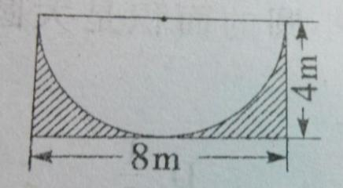

# Mathematics (Grade 6)

**ID**: 845aa37e
**难度**: medium
**题型**: short_answer

## 题目
求阴影部分周长.

## 解答

**答案**: 11.44

1. Step1:分析阴影部分周长的组成，可知其由长方形的一条长和两条宽以及半圆的弧长组成
2. Step2:计算长方形一条长和两条宽的长度和，长为8m，宽为4m，所以长度和为8 + 4×2 = 16m
3. Step3:计算半圆的弧长，已知圆的直径为8m，根据圆的周长公式C = πd（d为直径），可得半圆的弧长为3.14×8÷2 = 12.56m
4. Step4:计算阴影部分的周长，将长方形部分的长度和与半圆弧长相加，即16 + 12.56 - 8 = 11.44m

## 知识点

**知识点**:
  - --

---
