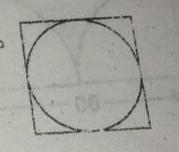

# Mathematics (Grade 6)

**ID**: 86e9843d
**难度**: medium
**题型**: short_answer

## 题目
如右图，已知正方形的面积是60平方厘米，求圆的面积。

## 解答

**答案**: 47.1（平方厘米）

1. Step1:设正方形边长为l，由正方形面积公式S = l²，已知正方形面积是60平方厘米，可得l² = 60
2. Step2:对l² = 60开方，求出正方形边长l = $\sqrt{60}$
3. Step3:因为圆是正方形的内切圆，所以圆的直径等于正方形的边长，圆的半径r = l/2，即r = $\sqrt{60}$/2 = $\sqrt{15}$
4. Step4:根据圆的面积公式S = πr²，π取3.14，可得圆的面积S = ($\sqrt{15}$)²×3.14 = 47.1平方厘米

## 知识点

**知识点**:
  - --

---
