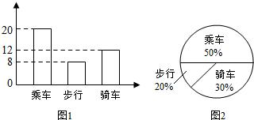

# Mathematics (Grade 6)

**ID**: 8fcddd92
**难度**: medium
**题型**: short_answer

## 题目
图1是某班学生外出乘车步行、骑车的人数统计图

①根据图1求出该班有多少名学生？
②若全年级有500人，根据图2给出的扇形统计图估计该年级步行人数．

## 解答

**答案**: 40, 100

1. Step1:从图1可知，乘车人数为20人，步行人数为8人，骑车人数为12人，将这三种出行方式的人数相加，即20 + 8 + 12 = 40人，得到该班学生总数
2. Step2:由图2可知步行人数占全年级人数的20%，全年级有500人，用全年级人数乘以步行人数所占比例，即500×20% = 100人，得到该年级步行人数

## 知识点

**知识点**:
  - 统计图表的综合分析、解释和应用．

---
