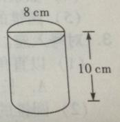

# Mathematics (Grade 6)

**ID**: 946c4f0c
**难度**: medium
**题型**: short_answer

## 题目
一个圆柱形礼物盒，底面直径是8厘米，高10厘米，用彩纸包起来，至少要用多少平方厘米彩纸？

## 解答

**答案**: 301.44

1. Step1:根据底面直径8厘米，计算底面半径为8÷2 = 4厘米
2. Step2:根据圆的面积公式S = πr²，计算底面积为3.14×4²平方厘米
3. Step3:根据圆柱侧面积公式S = 底面圆周长×高，底面圆周长 = πd，计算侧面积为3.14×8×10平方厘米
4. Step4:根据圆柱的表面积=底面积+侧面积，将底面积和侧面积相加，即3.14×4²+3.14×8×10 = 301.44平方厘米

## 知识点

**知识点**:
  - --

---
