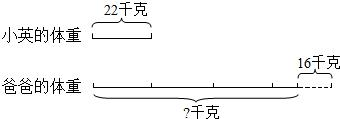

# Mathematics (Grade 6)

**ID**: 95299a18
**难度**: medium
**题型**: short_answer

## 题目
看图列式并计算．

## 解答

**答案**: 72

1. Step1:明确小英体重为22千克
2. Step2:根据题意可知爸爸体重比小英体重的4倍少16千克
3. Step3:先计算小英体重的4倍，即22×4 = 88千克
4. Step4:再计算爸爸的体重，用小英体重的4倍减去16千克，即88 - 16 = 72千克

## 知识点

**知识点**:
  - 整数、小数复合应用题

---
